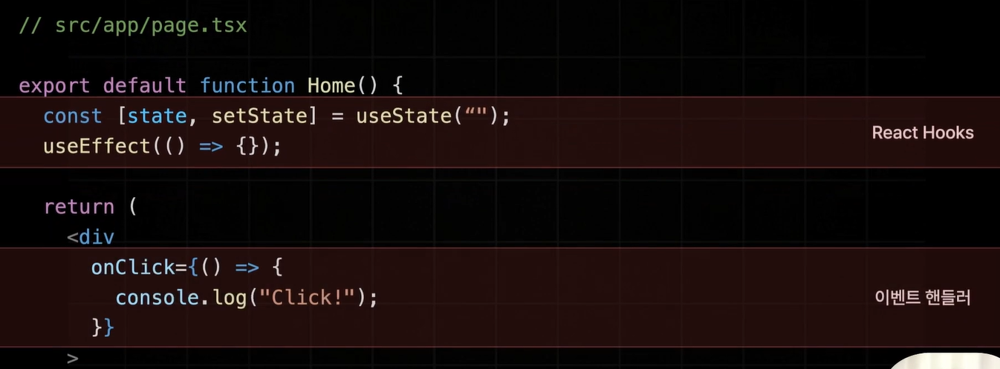
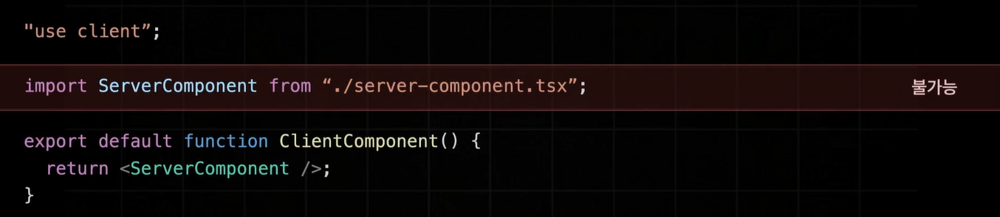
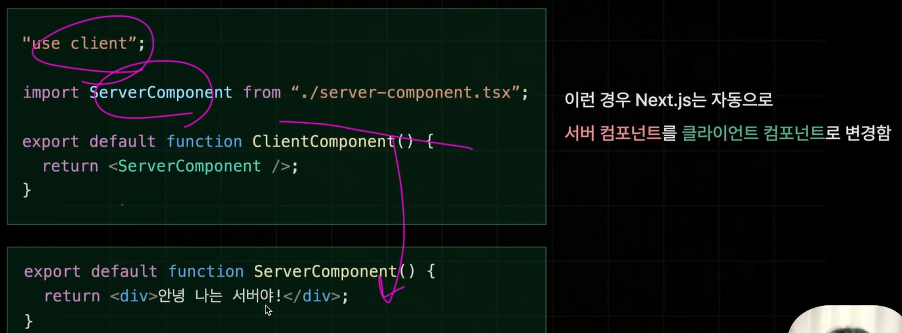
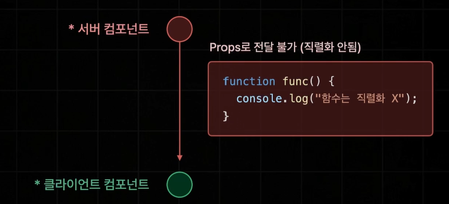
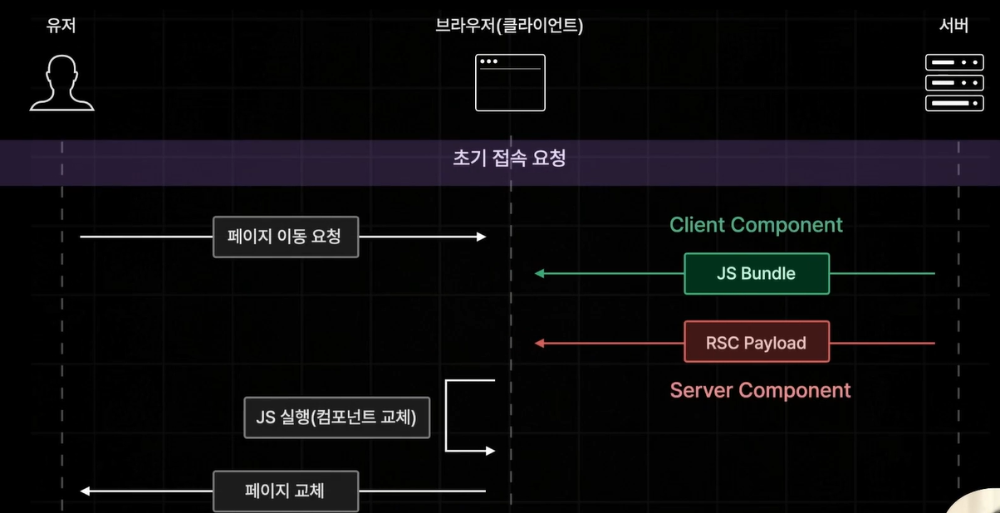

## React Server Component 주의 사항

1. 서버 컴포넌트에는 브라우저에서 실행될 코드가 포함되면 안된다
   

2. 클라이언트 컴포넌트는 클라이언트에서만 실행되지 않는다.

-> 서버 컴포넌트: 서버측에서만 실행되는 컴포넌트

-> 클라이언트 컴포넌트: 사전 렌더링을 위해 서버에서 1번 실행, 하이드레이션을 위해 브라우저에서 1번 실행 => 서버와 클라이언트에서 모두 실행됨

3. 클라이언트 컴포넌트에서 서버 컴포넌트를 import 할 수 없다.
   

-> 클라이언트 컴포넌트 코드: 서버와 브라우저에서 모두 실행됨

-> 서버 컴포넌트의 코드: 오직 서버에서만 실행됨

=> 이런 경우 Next.js는 자동으로 서버 컴포넌트를 클라이언트 컴포넌트로 변경함.

4. 서버 컴포넌트에서 클라이언트 컴포넌트에게 직렬화 되지 않는 Props는 전달 불가하다

**직렬화(Serialization)**

: 객체, 배열, 클래스 등의 복잡한 구조의 데이터를 네트워크 상으로 전송하기 위해 아주 단순한 형태(문자열, Byte)로 변환하는 것

: JS 함수는 직렬화가 불가능함.

: 서버컴포넌트에서 클라이언트 컴포넌트로 향하는 Props가 될 수 없음

**RSC Payload**

: React Server Component를 직렬화 한 결과

: 서버 컴포넌트의 렌더링 결과, 연결된 클라이언트 컴포넌트의 위치, 클라이언트 컴포넌트에게 전달하는 Props값 등의 데이터가 포함되어있음

## 네비게이팅

페이지 이동은 Client Side Rendering 방식으로 처리됨

